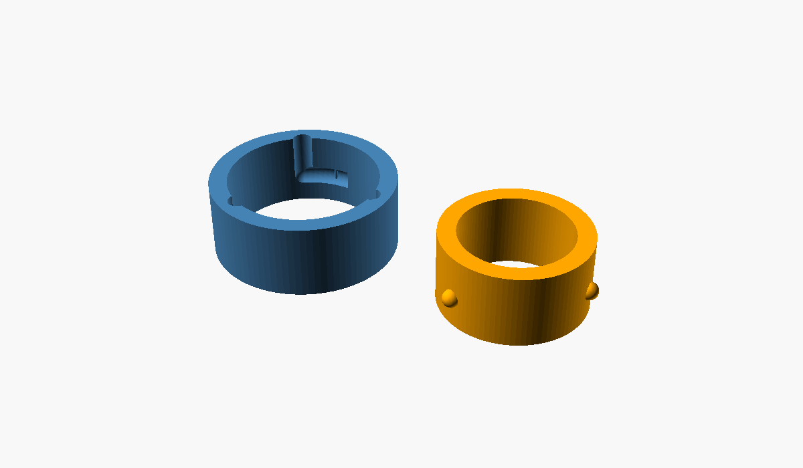
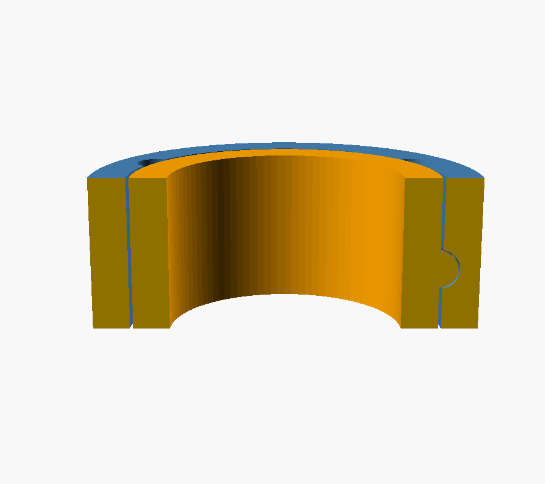

# bayonet-Lock-SCAD

<!-- markdownlint-disable MD060 -->

This OpenSCAD library provides a parametric bayonet lock connector, inspired by designs used in aviation maintenance for their reliability and ease of use. It produces both the pin and lock halves of the mechanism with a fully configurable number of locking points and turn direction.

Key features:

- Configurable number of locking pins (2 or more), evenly spaced or at explicit `pin_angles`.
- Optional keying: an uneven pin pattern gives the coupling a single locked orientation.
- Configurable interface radius (`interface_radius`) with optional shell wall thickness (`shell_thickness`) for any coupling diameter.
- Optional `entry_depth`; when omitted it defaults to `part_height * 0.5`.
- `pin_direction` parameter selects whether the pin protrudes inward or outward.
- Adjustable `allowance` (clearance gap) for tuning fit tolerance.
- Preview-aware `$fn` (64 preview / 128 render) for fast iteration.
- Optional `shell_only` mode that drops the locking features for fast assembly previews.

The design improves upon earlier versions by modularizing the code and addressing issues from the original implementation. Contributions and feedback are welcome.





## Usage

```scad
use <bayonet_lock.scad>;

bayonet(
  half            = "pin",    // "pin" | "lock"
  interface_radius = 10,
  shell_thickness = 2.5,       // optional; defaults to pin_radius * 2
  allowance       = 0.2,
  part_height     = 10,
  // entry_depth  = 5,        // optional; defaults to part_height * 0.5
  number_of_pins  = 3,        // or pin_angles = [...], see keying below
  pin_radius      = 1,
  sweep_angle     = 30,       // degrees; must be < bayonet_max_sweep_angle(...), see below
  pin_direction   = "outer",  // "inner" | "outer"
  turn_direction  = "CW",     // "CW" | "CCW"
  // shell_only   = false     // optional; omit the locking features, see below
);
```

## Keying the locked orientation (`pin_angles`)

Evenly spaced pins carry that spacing's rotational symmetry, so an n-pin coupling has **n
indistinguishable locked positions**. Nothing in the geometry prefers one: a 3-pin half mates
just as happily at 0°, 120° and 240°.

That is harmless while both halves are axisymmetric, and wrong the moment one of them carries
an orientation — a baffle, a tilted sensor, a keyed connector. Such a part seated one position
out locks correctly and points somewhere else, with no resistance to tell the assembler.

`pin_angles` places the pins outright instead of spacing them evenly. Any unequal spacing
removes the symmetry, which is how a BA15d lamp cap keys its two pins:

```scad
pin_angles = bayonet_keyed_pin_angles(3, 25);   // [0, 95, 240] - evenly spaced, one pin back 25°

bayonet(half = "lock", pin_angles = pin_angles, ...);
```

Give exactly one of `number_of_pins` or `pin_angles`.

`sweep_angle` must be less than `bayonet_max_sweep_angle(pins, interface_radius, pin_radius,
allowance)`: the smallest gap between pins, less two channel half-angles. Each channel runs on
past its sweep, so as the sweep grows its end wall thins against the next pin's entry shaft
and then goes, and an over-turned pin reaches that shaft and lifts out. Measured on five
geometries, the stop is lost 1.7 to 1.9 half-angles short of the next pin. For 3 pins at
`interface_radius = 10`, `pin_radius = 1` and `allowance = 0.2`, the limit is 107.4°, where the smallest gap alone
would allow 119°.

**Being keyed is not the same as being blocked.** Symmetry only says a wrong seating is not
*identical*; whether it is *prevented* depends on how far the offset throws the pins clear of
the channel mouths. Check the margin against the mouth's half-width:

```scad
assert(bayonet_pin_pattern_margin(pin_angles)
       > bayonet_channel_half_angle(interface_radius, pin_radius, allowance));
```

A key smaller than that still reads as keyed and still lets a wrong attempt start to go in.

| Function                                                          | Returns                                                                  |
| ----------------------------------------------------------------- | ------------------------------------------------------------------------ |
| `bayonet_keyed_pin_angles(number_of_pins, key_angle)`             | Even spacing with the second pin brought back by `key_angle`             |
| `bayonet_pin_pattern_order(angles)`                               | Rotational symmetry order; `1` is keyed, even spacing gives the pin count |
| `bayonet_pin_pattern_is_keyed(angles)`                            | `order == 1`                                                             |
| `bayonet_pin_pattern_margin(angles)`                              | Degrees by which the worst pin misses a mouth at the easiest wrong seating |
| `bayonet_pin_pattern_min_gap(angles)`                             | Smallest gap between adjacent pins                                       |
| `bayonet_channel_half_angle(interface_radius, pin_radius, allowance)` | Angular half-width of the entry shaft                                |
| `bayonet_max_sweep_angle(pins, interface_radius, pin_radius, allowance)` | The ceiling on `sweep_angle`; `pins` is a count or a list of angles |
| `bayonet_locked_rotation(sweep_angle, turn_direction)`            | Turn from entry (common origin) to locked: `-sweep_angle` CW, `+sweep_angle` CCW |

## Fast assembly previews (`shell_only`)

The locking channel is a boolean-heavy cut, so an assembly holding several bayonets becomes
slow to pan long before it becomes slow to render. `shell_only` drops the pin and channel
features and emits just the bare coupling shell — same shell radii, same height, no locking
geometry.

The pin bosses are features, so they go too: a pin half previews `pin_radius` smaller in
radius than it prints. Preview the couplings this way to see where they sit, not to judge
clearance against whatever sits next to them. Rendering with `shell_only` still active echoes
a warning, since the emitted part would have nothing to lock with.

Because assemblies are previewed and only parts are rendered, the natural wiring is
`$preview`. `shell_only` falls back to the dynamically scoped `$bayonet_shell_only` special
variable, so an assembly opts in **once** at its top level rather than threading an argument
through every intermediate module:

```scad
$bayonet_shell_only = $preview;   // F5 previews bare shells, F6 renders the real geometry
```

That reaches every `bayonet()` call below it, including calls buried inside your own modules.
An explicit `shell_only=` argument always wins over the special variable, so a single joint
can stay fully detailed while the rest of the assembly stays light, and `let()` scopes it to
part of a tree:

```scad
let($bayonet_shell_only = true) my_subassembly();
```

Validation is unaffected: every parameter is checked in `shell_only` mode too, so a preview
that passes will not surprise you with an assertion at render time.

> **Note for forks:** setting `$bayonet_shell_only` in *your own* file is the intended usage
> above. What does not work is declaring a default at the top level of `bayonet_lock.scad`
> itself — a top-level assignment in a `use`d file shadows the consumer's value, silently
> pinning it to the library's default. The library resolves it with `is_undef` for that
> reason.

The saving scales with the number of joints. In
[`examples/assembly_shell_only_preview.scad`](examples/assembly_shell_only_preview.scad)
the mode cuts the CSG tree from 752 nodes to 240, and removes every `rotate_extrude` and
channel cut except those of the one joint that opts out. On a comparable eight-half assembly
at `$fn = 64`, the CGAL render drops from ~104 s to ~3.8 s.

## Mating the two halves

Both halves are authored in a single frame. Instantiated at a common origin with matching
parameters they are at the **entry position**: the pins sit at the channel mouths, and the pin
half lifts straight back out.

```scad
bayonet(half = "lock", ...);
bayonet(half = "pin",  ...);   // same origin, same parameters => entry, not yet turned
```

To show them **locked**, turn the pin half by `bayonet_locked_rotation(sweep_angle,
turn_direction)`: `-sweep_angle` for `"CW"`, `+sweep_angle` for `"CCW"`. There the pins sit at
the channel ends and a straight lift is blocked:

```scad
rotate([0, 0, bayonet_locked_rotation(sweep_angle, turn_direction)])
  bayonet(half = "pin", ...);   // locked
```

A part that has to face a particular way once locked (a keyed connector, a baffle) is
therefore drawn turned back by the same angle, or its pins are: both consumers of this library
that care about orientation do one or the other. Any rotation between entry and locked is a
valid mid-travel position. All of this holds for any
`entry_depth`, and throughout that range the halves stay clear of each other, so an
`intersection()` of the two that is non-empty means the parameters do not match.

See the [`examples/`](examples/) directory for ready-to-render configurations:

| File                                                                  | What it shows                              |
| --------------------------------------------------------------------- | ------------------------------------------ |
| [`outer_3pin.scad`](examples/outer_3pin.scad)                         | Outer pin, 3 pins, CW, custom entry depth  |
| [`inner_2pin.scad`](examples/inner_2pin.scad)                         | Inner pin, 2 pins, CCW, default entry depth |
| [`inner_3pin_thick_shell.scad`](examples/inner_3pin_thick_shell.scad) | Inner pin, 3 pins, explicit thick shell    |
| [`outer_4pin_ccw.scad`](examples/outer_4pin_ccw.scad)                 | Outer pin, 4 pins, CCW, default entry depth |
| [`minimal.scad`](examples/minimal.scad)                               | Bare minimum call, default shell and entry depth |
| [`keyed_3pin.scad`](examples/keyed_3pin.scad)                         | Keyed 3 pins, one locked orientation, with the blocked seating shown |
| [`assembly_shell_only_preview.scad`](examples/assembly_shell_only_preview.scad) | Multi-joint assembly using `$bayonet_shell_only = $preview` |

The first five render the lock and pin side-by-side for visual inspection. `keyed_3pin.scad`
shows the halves locked and, beside them, the intersection at a wrong seating that a keyed
pattern refuses; `assembly_shell_only_preview.scad` shows them assembled into a multi-joint
model.

## Parameter reference

| Parameter          | Type                   | Description                                                                                                                   |
| ------------------ | ---------------------- | ----------------------------------------------------------------------------------------------------------------------------- |
| `half`             | `"pin"` \| `"lock"`    | Which half to generate                                                                                                        |
| `interface_radius` | mm > 0                 | Canonical mating radius where the pin centerline and lock channel are referenced                                              |
| `shell_thickness`  | mm > 0, optional       | Radial thickness from the interface to the inner or outer shell; defaults to `pin_radius * 2`                                 |
| `allowance`        | mm ≥ 0                 | Radial clearance applied ±allowance/2 around the mating surface                                                               |
| `part_height`      | mm                     | Total axial height of the connector                                                                                           |
| `entry_depth`      | mm, optional           | Insertion depth from the top face before the bayonet turn begins; defaults to `part_height * 0.5`; `part_height - entry_depth` must be ≥ `pin_radius + allowance/2` so the channel stays inside the part |
| `number_of_pins`   | int ≥ 1, optional      | Number of locking points, spaced evenly; give this or `pin_angles`, not both                                                  |
| `pin_angles`       | list of degrees, optional | Explicit pin positions, replacing even spacing; an unequal pattern keys the coupling to one locked orientation             |
| `pin_radius`       | mm                     | Radius of the locking pin sphere; explicit `shell_thickness` values must satisfy `pin_radius + allowance/2 ≤ shell_thickness` |
| `sweep_angle`      | degrees                | Arc the pin travels; must be > 0 and < `bayonet_max_sweep_angle(...)`, which keeps the lock a turn stop                |
| `pin_direction`    | `"inner"` \| `"outer"` | Whether the pin protrudes toward the bore or toward the OD                                                                    |
| `turn_direction`   | `"CW"` \| `"CCW"`      | Direction of the locking rotation                                                                                             |
| `shell_only`       | bool, optional         | Omit the pin/channel features and emit only the bare shell; defaults to `$bayonet_shell_only`, then `false`                    |

## Checks

`just test` takes about 6 s on OpenSCAD 2026.10.15 and checks the coupling as a mechanism,
for inner and outer pins, both turn directions, 2 to 4 pins, keyed patterns, and the sizes of
two projects that use this library:

- at entry (a common origin) the halves are clear and the pin half lifts straight out;
- turned by `bayonet_locked_rotation()` they are clear and a straight lift is blocked;
- turned the wrong way, they collide, and turned on past locked, the lock stops the pin;
- just under `bayonet_max_sweep_angle()` the turn stop still holds, and just over it the
  assert refuses the sweep; the channel-depth limit holds at its boundary;
- a keyed pattern blocks the seating an even one accepts;
- the helper functions, `shell_only`, every example, and each half's volume against
  `tests/volumes.txt` (`just volumes` rewrites it after an intended geometry change).

`just images` renders the pictures above.

## Versions

Releases from 0.11.0 on are tagged: pin a tag, such as `v0.12.0`, rather than a commit. See
[CHANGELOG.md](CHANGELOG.md).

## License & Attribution

Originally developed by [xavierasx](https://www.thingiverse.com/xavierasx), this is a rewritten version of [bayonet Lock Connector library V2.1](https://www.thingiverse.com/thing:6536797) which is originally licensed under **CC BY**.
